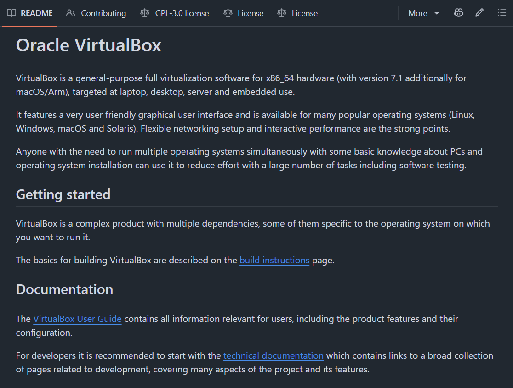
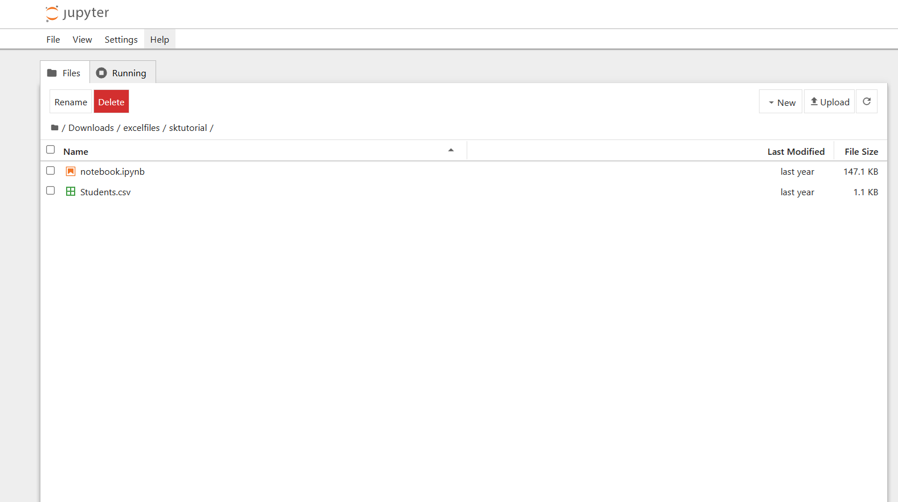
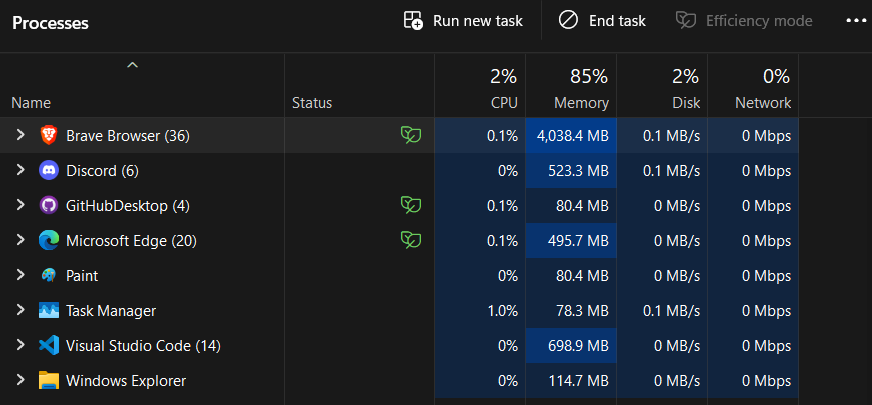
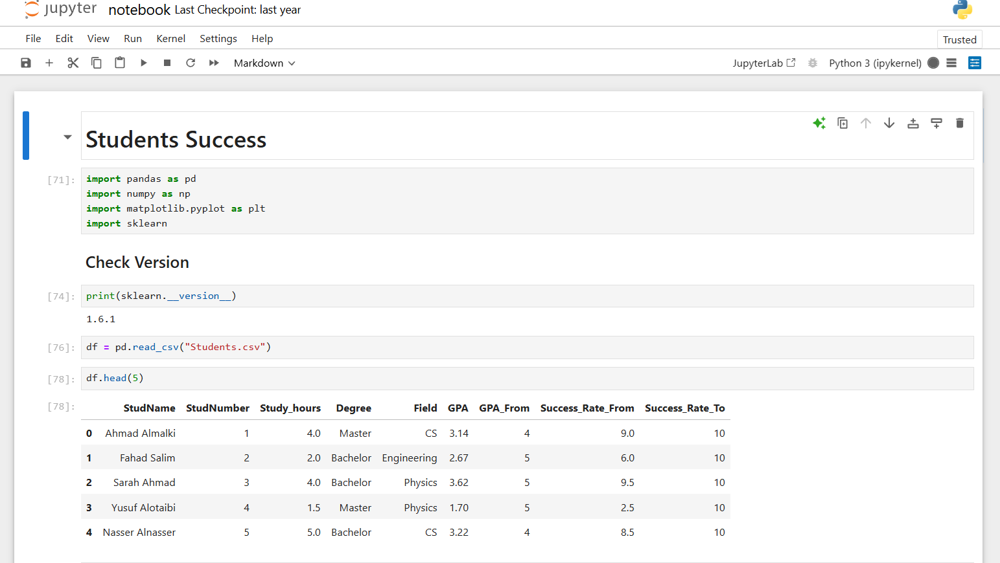

تعد دفاتر جوبيتر من أهم البيئات التفاعلية في علم البيانات والذكاء الاصطناعي والتي ينبغي أخذ نبذة عنها

دفاتر جوبيتر أو :

**Jupyter Notebooks**

هي بيئة حوسبة وتنفيذ أكواد تفاعلية مفتوحة المصدر تسمح بكتابة أكواد في خلايا منفصلة وليست في ملف كاملاً بحد ذاتها , مما يشكل ميزة مهمة جداً


يمكن كذلك لكل خلية أن يكون فيها مُخرجات خاصة بها أو ربط الخلايا مع بعض بشرط تنفيذها بشكل تدريجي , كما يمكن كتابة التوضيحات بلغة ترميزية تدعى بالـ :

**Markdown**

وهي ملفات ترميزية تشبه الأتش تي ام ال لكن مخصصة لكتابة المستندات , منتشرة جدا في كتابة وصف المشاريع على منصة قيتهب

كما أنك تقرأ مقالة الآن مكتوبة بالماركداون مباشرة :)



### أصل التسمية

جوبيتر في الواقع هي دمج لغوي بين أشهر ثلاث لغات في عالم البيانات تم تصميم الأداة للتعامل معها وهي :

- Python
- R
- Julia

ولغة آر هي اللغة التي أستخدمها مع إطار عمل كوارتو لتصميم المدونة هذه .

### مثال على نظام الخلايا

كود يطبع نتيجة في بايثون :

```{python}
print("أهلا من بايثون")
```


وهي تعتبر خلية جوبيتر , جوبيتر مدعوم تلقائياً في إطار عمل كوارتو الذي أنشئت به هذه المدونة

#### مثال أوضح :

```{python}
name = 'Saad'
```

ثم ننفذ الثانية

```{python}
print(name)
```

نلاحظ هنا أنها احتفظت بالمتغير السابق من الخلية الأولى ونفذته في الثانية رغم كونهم برنامجين مستقلين عن بعضها البعض , وهذا يفيد لاحقاً في الدفاتر الكبيرة حيث تفصل الرسوم البيانية عن الاحصاءات وتحليل البيانات وتدريب النماذج .

### التحميل

في الواقع يمكنك إستخدام عدة أشكال من دفاتر جوبيتر

- Jupyterlab :

هي نسخة الويب من دفاتر جوبيتر , سريعة وجيدة الأداء لكن تحتوي على بعض المشاكل وقد لاتتوافق مع بعض المكتبات وقد تحتاج حتى لتثبيت النسخة الكاملة على جهازك لضمان العمل

- Jupyter Notebook :

يمكن تثبيته مع حزمة برمجيات أناكوندا من هذا الرابط :

[تنزيل حزمة برمجيات أناكوندا](https://anaconda.org/channels/anaconda/packages/jupyter/overview)

لكن مشكلتها أنها قد تقوم بتحميل بعض الأشياء التي لا تريدها فقط تلجئ للحل الآخر الأصعب قليلاً وهو تحميلها عبر سطر الأوامر

أولاً تتأكد من تثبيت لغة بايثون بشكل محلي مع نسخة حديثة نسبياً تدعم جوبيتر وتنفذ الآتي :

`pip install --upgrade pip`

لتحديث مُحمل الحزم الخاص بلغة بايثون

ثم :

`pip install notebook`

وعندما تريد أن تدخل للبرنامج تكتب الامر :

`jupyter notebook`

في نفس سطر الأوامر , وسيفتح لك معاينة في صفحة ويب محلية برابط :

`http://localhost:8888/tree`

يستعرض فيها ملفاتك المحلية على جهازك حيث يمكنك انشاء دفاتر جوبيتر بسهولة



- Google Colab :

خدمة من خدمات شركة جوجل المبنية على دفاتر جوبيتر , لعدة أسباب من ضمنها :

- سهولة الإستخدام :
لست مضطراً لتثبيت جوبيتر منذ الصفر

- سهولة إرتباطه مع جوجل درايف :
يمكن إيجاد الدفاتر المُنشئة بسهولة

- كروت شاشة مجانية وقوية :
إذ أن كروت الشاشة أهم قطعة في جهاز الكمبيوتر تقريباً لتدريب نماذج الذكاء الاصطناعي المتقدمة حالياً

- سهولة المشاركة :
بدلاً من ضرورة رفع الملف نفسه , يمكن مشاركة رابط معاينة للدفتر نفسه

- عدم إستهلاك موارد الجهاز :
لا يحتاج تدريب نماذج الذكاء الاصطناعي تدريبه بإستخدام معالجك أو كرت شاشتك الخاص , بل يتم ذلك عبر السحابة في جوجل كولاب بشكل شبه كامل .

"هذا لايعني أن الموقع نفسه والمتصفح لا يستهلك شيء من موارد جهازك , بالعكس في العصر الحالي المتصفح يأخذ نسبة عالية من الإستهلاك أساسا"

ونلاحظ أنه أسفل برنامج متصفح بريف 36 عملية !!! وتستنزف 4 قيقا بايت من طاقة الرام وهو مايعد شيئا جنونياً في عصرنا الحالي :



### الإمتداد

إمتداد ملفات الدفاتر الذي يحوي خلايا الأكواد وخلايا الماركداون ينتهي بـ :

`ipynb`




## مصادر ومراجع :
- [Anaconda Docs - Jupyter Notebook](https://www.anaconda.com/docs/psm-on-prem/6.8.0/user/notebook)
- [Colab - Google for Developers](https://developers.google.com/colab)