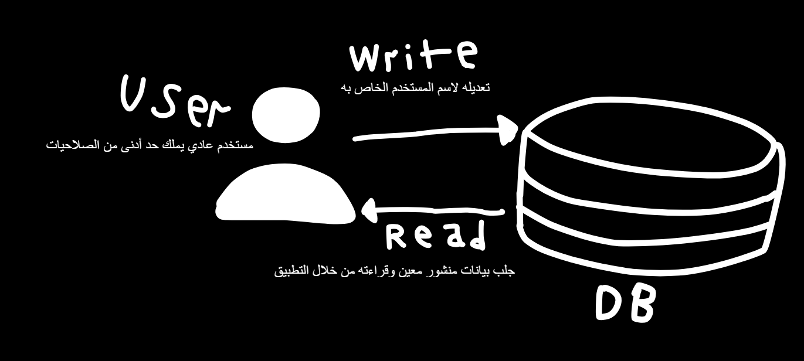
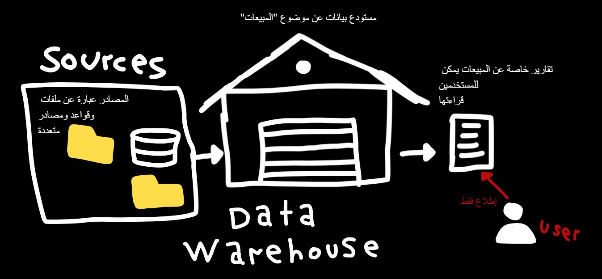
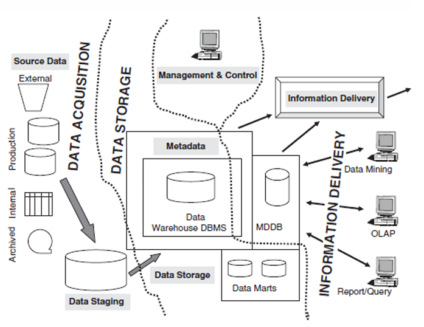
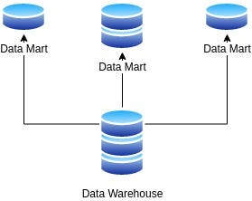
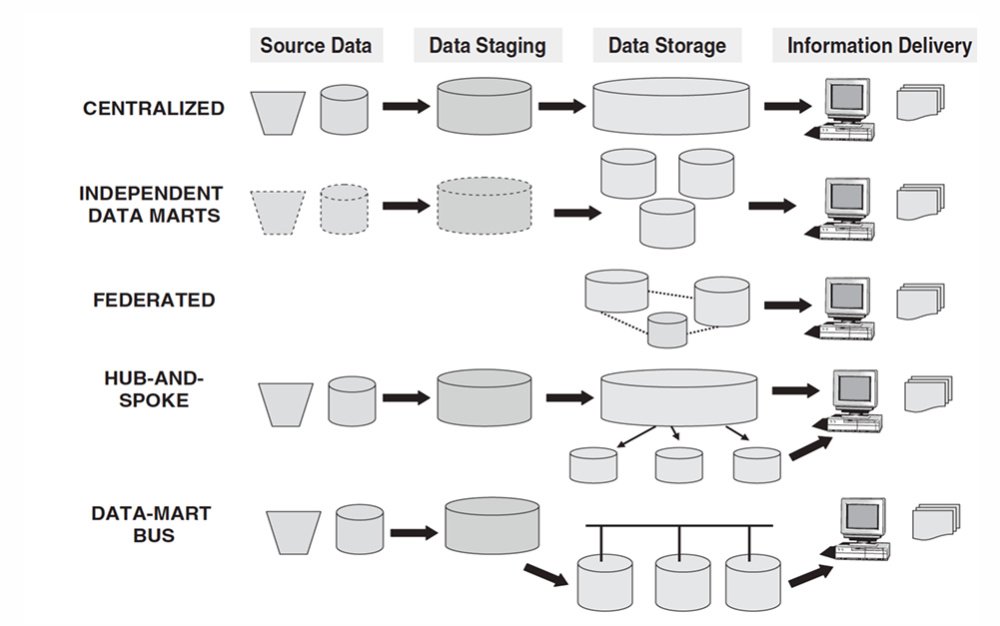

مستودع البيانات هو نموذج تخزين للبيانات يختلف عن قواعد البيانات بأنه يجلب البيانات من مصادر عدة بهدف تحليلها

[يُستحسن مراجعة قواعد البيانات مسبقاً](https://saadaiblog.netlify.app/blog/post26)

### مستودعات البيانات ضد قواعد البيانات

قواعد البيانات أو ما تعرف بالـ :

`OLTP - OnLine Transactions Processing`

هي أنظمة عالمية ومعروفة تُستخدم لتخزين البيانات وجلبها , وهي دائماً ما تُستخدم في التطبيقات وأغلب أنظمة اليوم

هي نوعين أساسية

- علائقية :

وهي التي تستخدم لغة الاستعلامات العلائقية المعروفة بالـ :

`SQL`

وغالباً تكون البيانات نصية وتُخزن على شكل جداول

وأنظمتها تعرف بأنظمة RDBMS

مثل : MySQL - Oracle - Microsoft SQL Server - PostgreSQL

- غير علائقية :

تستخدم تقنيات أخرى في تخزين البيانات مثل :

`JSON-XML-CSV`

وطبعاً قاعدة البيانات غالباً تتكون من بيانات حديثة تخص التطبيق أو النظام نفسه ويتمكن القارئ من جلب بيانات معينة منها حتى بدون إطلاع كامل عليها

مستخدم عدل اسم المستخدم الخاص به فتغيرت في قاعدة البيانات ثم قام بقراءة منشور تم جلبه من قاعدة البيانات :

وغالباً العمليات الرئيسية في قواعد البيانات تسمى :

`CRUD`
وهي إختصاراً لـ :

- Create/إنشاء
- Read/قراءة
- Update/تعديل
- Delete/حذف

---

أما مستودع البيانات فهو نظام مصمم ومخصص لتخزين عدد كبير من البيانات مثل قواعد البيانات لكن بشكل أكبر قليلاً , والهدف منها إنتاج تقارير وتحليلات خاصة يتمكن المستخدمين من قراءتها فقط دون تعديل .

ويٌعرف المستودع بالـ :

`OLAP - OnLine Analytical Processing`

والهدف هو تكوين مركز موحد يخزن البيانات وتحليلها ثم إصدار مخرجات بناء عليها لتساعد المستودعات في عملية إتخاذ القرار في عالم ذكاء الأعمال .

و لايمكن تكوين المستودع أساساً إلا بقاعدة بيانات واحدة على الأقل في الشركة , وليس شرطاً من أن تكون البيانات فقط قواعد بيانات الشركة نفسها فمن الممكن أن تكون على النحو الآتي :

- ملفات مؤرشفة : 

جداول بيانات إكسل قديمة , بيانات مبيعات سنوات سابقة , جداول موظفين وعملاء

- ملفات داخلية :

قواعد بيانات أقسام معينة - ملفات موظفين حاليين

- ملفات خارجية :

ملفات من خارج المؤسسة كلياً

#### لماذا تحتاج الشركات للمستودعات ؟

لأن مستودعات البيانات أصبحت جزء رئيسي من الشركات المتوسطة والكبيرة لمعرفة قياس أرباحها ومساعدة المسؤولين فيها على إتخاذ القرارات الحادة والمصيرية .

#### هل من الممكن دمج القواعد والمستودعات في نظام واحد ؟

من الصعب أن يتم ذلك , لثلاثة أسباب رئيسية ومهمة

##### إختلاف تمثيل البيانات

قاعدة البيانات معقدة أكثر من التصميم البنيوي وتتكون من عدة جداول مركبة ومعقدة وغالباً تكون مُطبعة أي تطبق نظام تطبيع البيانات وتنظيمها بشكل أكبر

أما مستودع البيانات فهو شكل غير مُطبع وأحياناً فوضوي أكثر ويحتوي على جداول أقل يجعلها سهلة الفهم أكثر من قاعدة البيانات

##### إختلاف السرعة

قاعدة البيانات سريعة جدا لخدمتها للمستخدمين ويجب أن تكون متماسكة ومُحدثة وموجودة في كل وقت .

أما المستودع فقد يضغط على موارد الأجهزة ويحجز جزء من موارد السيرفر , فلو تم دمج الإثنين سيكون أداء قاعدة البيانات سيئاً جداً .

##### التحليل يحتاج لمصادر عدة
ومن المستحيل ذلك , فقاعدة البيانات لوحدها مصدر واحد

#### مستخدمين مستودعات البيانات

- المستخدم المبتدئ :

مستخدم بلا خبرة وقد يكون فقط من باب التجربة أو مرات قليلة لأخذ المطلوب فقط

- المستخدم العادي :

هو مستخدم غالباً غير تقني ولا يهتم لما خلف الكواليس , هو فقط يهتم بمعلومات مجهزة خاصة به تأتي من المستودع

- محلل الأعمال :

هو مستخدم مهتم بأخذ البيانات من المستودع لإجراء تحليلات عليها

- مسؤول المستودع

المعروف بالـ :

`Power User`

وهو المسؤول عن إدارة المستودع والدخول في طبقة البيانات وإصدار التقارير الخاصة وإجراء إستعلامات مخصصة .

#### معمارية مستودعات البيانات

تتكون المستودعات من 3 طبقات رئيسية :

- Data Acquisition / جمع البيانات

وفيها طبقتين فرعية
وهي طبقة البيانات نفسها وطبقة :

`Data Staging`
بمعنى طبقة تجهيز البيانات

- Data Storage / تخزين البيانات :

في المستودع أو متاجر البيانات

- Information Delivery :

وهي طبقة عرض البيانات للمستخدمين

مع طبقتين إضافية مساعدة :

- Metadata :
أو قاموس البيانات وهي بيانات وصفية عن البيانات والمستودع كله

- Management and Control :
طبقة إدارة الطبقات كلها بإستخدام البيانات الموجودة في قاموس البيانات

#### متاجر البيانات
هي مستودعات بيانات صغيرة تخدم قسم واحد أو ذات هدف محدد فقط

من الممكن أن يكون هناك مستودع بلا متاجر بيانات

ومن الممكن أن يكون هناك متاجر بلا مستودع , قد تتواصل المتاجر بينها البين أو ربما تكون مستقلة بذاتها

وغالباً يكون هناك مستودع تحته متاجر بيانات

#### أنواع مستودعات البيانات

- Centralized / مركزية :

فقط مستودع بيانات يُستخدم للتخزين وإجراء التحليل , يُعتبر نسخة واحدة من المعرفة , والبيانات غالباً تكون مُطبعة وجاهزة

والمستخدمين ينشئون الاستعلامات منه مباشرة

لكن عيوبه كثيرة مثل تكلفة إنشائه العالية وصعوبة بنائه أو حدوث أزمة في فعاليته وقدرته ما تعرف بالـ :

**عنق الزجاجة**

حيث يُصبح الأداء بطيئاً ومزعجاً

- Independent Data Marts / متاجر بيانات مستقلة :

وهي متاجر بيانات بلا مستودع مركزي , سهلة التكلفة والإنشاء لكن كل مستودع لديه رؤيته الضيقة حول البيانات وكل متجر يتعامل مع المستخدم المقصود بالاستعلامات , أما البيانات فغالباً تكون غير جاهزة وغير مُطبعة .

- Federated / المجموعة ببعض :

تكوين مستودع من خلال محاولات سابقة مثل محاولة إنشاء مستودعات أو متاجر بيانات أو حتى نظام ويب شبيه , تشبه متاجر البيانات المستقلة لكن مع بيانات مُجهزة ولا تحتاج لجلب البيانات أصلاً كون البيانات جزء من النظام نفسه .

- Hub and Spoke / المركز والأفرع :

تقريبا هي دمج أول نظامين , حيث يوجد مستودع مركزي مع متاجر بيانات فرعية تعتمد عليه

المستودع يتم تخزين فيه البيانات أما الاستعلامات فغالباً من متاجر البيانات وقد تكون أحياناً من المستودع نفسه

- Data Bus Matrix / مصفوفة باص البيانات :

بيانات في خط مشترك بدون مستودع بيانات مركزي بأبعاد معينة حيث من الممكن إعادة استخدامها

### من الأعلى للأسفل ضد من الأسفل للأعلى

أي طريقة يتم بناء فيها المستودع أولاً تعتبر من أعلى لأسفل وهي طريقة التقني :

`Bill Inmon - بيل إينمون`

وأي طريقة يتم البدء فيها بالمتاجر أولاً تعتبر من أسفل لأعلى وهي طريقة التقني :

`Ralph Kimpall - رالف كيمبال`

فلذلك يعتبر التصنيف كالآتي

- أعلى لأسفل :
المركزية + المركز والأفرع

- أسفل لأعلى :
متاجر البيانات المستقلة + باص البيانات

- بدون شكل معين :
المجموعة ببعض , لأنها بقايا نظام سابق أساساً

## مصادر ومراجع :

- [IBM - ماهي مستودعات البيانات ؟](https://www.ibm.com/sa-ar/think/topics/data-warehouse)
- [Oracle - ماهي مستودعات البيانات ؟](https://www.oracle.com/sa-ar/database/what-is-a-data-warehouse/)
- [SAP - مستودع البيانات , المفهوم والتكوين والبنية](https://www.sap.com/mena-ar/products/data-cloud/datasphere/what-is-a-data-warehouse.html)
- SQL - For Dummies
- [Taif University - 502478-3 | Data Warehouses](https://www.tu.edu.sa/Attachments/ce5b27aa-3a1a-4d83-8407-4ded937729b9_.pdf)